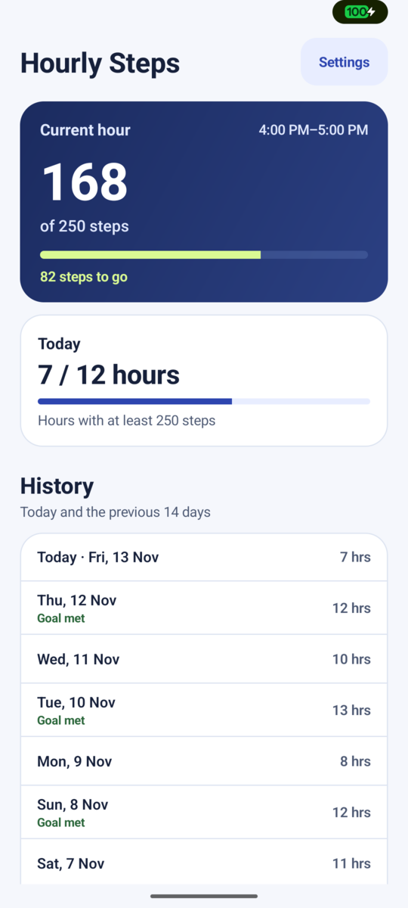

# Hourly Steps Reminder

A native, offline Android app for Samsung Galaxy Z Fold4 (Android 10+). Uses **the phone's own `TYPE_STEP_COUNTER` sensor**, not Samsung Health, Google Fit, or the Galaxy Fit3.

## Screenshot



## Defaults
- 250 steps per clock hour
- Reminder at :45 (15 minutes before hour end), **only if below target**
- 12 successful hours per calendar day, counted across all 24 hours
- Notifications only for hours starting 08:00 through 21:00 (08:00–22:00)
- Today + previous 14 calendar days of successful-hour totals

## Permissions and phone settings
On first launch, grant Physical Activity and Notifications. For accurate timing, use the **Allow precise reminders** button (Alarms & reminders special access). Samsung battery restrictions may stop monitoring; configure the app as **Unrestricted** under battery settings. Opening the app after reboot may be necessary on newer Android versions.

## Known limitations
- The Android step-counter sensor reports cumulative steps since reboot, not timestamped individual steps. This prototype attributes only changes observed within the same hour and no more than 2 minutes apart. **It intentionally drops unassignable increments**, so hour totals can undercount, especially after inactivity, sensor batching, a reboot, or Android killing the service.
- A foreground notification is used to help maintain sensor monitoring. Android does not guarantee continuous delivery; the sensor may be absent or restricted on some devices.
- When the sensor produces no events, the app cannot distinguish zero steps from missing sensor data. Historical hours currently display zero in either case; this is a known issue to address before trusting the daily statistics.
- Changes to the hourly threshold recalculate success from recorded counts; older data is not rewritten.
- The notification time can be delayed when exact-alarm access is unavailable. After granting exact-alarm access, reopen the app to reschedule.
- No automated tests or device validation have been run.

## Future development
Use a more reliable sensor event and timestamp strategy; explicitly mark coverage gaps; add monitoring health indicators, and tests for hour/day/DST transitions. Consider a phone-only Health Connect data source only if it can reliably distinguish phone-sourced steps from wearable steps.

## Build
Build from the project directory with JDK 17 and Android SDK Platform 35. On macOS with Homebrew Java and the SDK in its default location:

```sh
export JAVA_HOME="$(brew --prefix openjdk@17)/libexec/openjdk.jdk/Contents/Home"
export ANDROID_HOME="$HOME/Library/Android/sdk"
./gradlew assembleDebug
```

If your SDK is elsewhere, set `ANDROID_HOME` to that directory. The APK is written to `app/build/outputs/apk/debug/HourlyStepsReminder.apk`.
